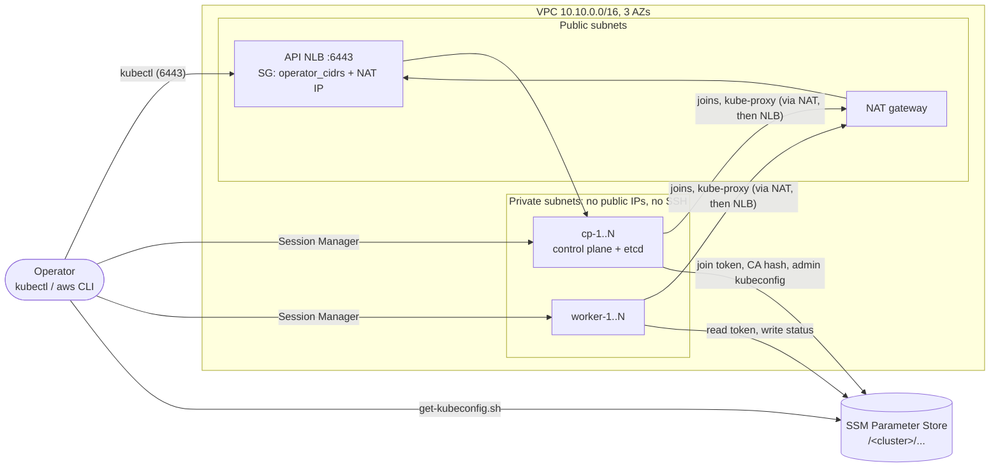

# kube-lab: kubeadm Kubernetes cluster on AWS for CKA / CKS / CKAD practice

`terraform apply` builds a vanilla kubeadm cluster (Kubernetes **1.36.5**) on EC2 with
every node `Ready`, a CNI, and metrics-server. You can then forget about the infrastructure
and practise on the cluster itself: kubeadm upgrades, etcd backup and restore, and security
hardening.

> **Learning only.** A single NAT gateway, one etcd member by default and an internet-facing
> API make this unfit for production. Destroy it after every session (about $0.23/h).

## Architecture



- **Nodes** run Ubuntu 24.04 (Canonical AMI) in private subnets. Software: containerd 2.3 from
  Docker's apt repo, and kubeadm, kubelet and kubectl from `pkgs.k8s.io`. Nodes have encrypted gp3
  root volumes and require IMDSv2 with hop limit 1.
- **The API** is served by an internet-facing NLB, which is also the kubeadm `controlPlaneEndpoint`
  for any number of control planes. Its security group only admits `operator_cidrs` and the NAT IP.
- **Bootstrap** runs entirely in cloud-init. cp-1 runs `kubeadm init`, publishes join material to
  SSM SecureString parameters and installs the CNI, kubelet-csr-approver and metrics-server. The
  other nodes poll SSM and then join. Control planes join one at a time because etcd admits one
  learner at a time.
- **Terraform state holds no secrets.** The parameters are created write-only (`value_wo`) and
  filled in by the nodes. There are no Kubernetes or Helm providers.

## Prerequisites

| Tool | Version | Why |
|------|---------|-----|
| Terraform | ≥ 1.11 | write-only arguments |
| AWS CLI v2 + [Session Manager plugin](https://docs.aws.amazon.com/systems-manager/latest/userguide/session-manager-working-with-install-plugin.html) | current | kubeconfig download, shell access |
| kubectl | 1.36 or 1.37 | |
| bash, jq | any | helper scripts |

You also need AWS credentials allowed to create VPC, EC2, ELB, IAM and SSM resources, and to call
`ssm:GetParameter` with `kms:Decrypt` on the `aws/ssm` key.

## Quick start

```bash
cp terraform.tfvars.example terraform.tfvars
# Set operator_cidrs to your public IP as /32. It is required and has no default.
terraform init
terraform apply

# Bootstrap takes about 10-20 minutes after apply.
$(terraform output -raw wait_command)
eval "$($(terraform output -raw kubeconfig_command))"
kubectl get nodes -o wide
kubectl top nodes
```

To make `terraform apply` itself block until the cluster is ready, set `wait_for_cluster = true`.
This runs `scripts/wait-for-cluster.sh` locally and needs bash and the AWS CLI.

Tear down with `terraform destroy`. It removes everything, including the SSM parameters.

## Access

- **kubectl:** `scripts/get-kubeconfig.sh <cluster> [region]` writes `~/.kube/<cluster>.yaml`
  with mode 0600 and prints an `export KUBECONFIG=...` line. It uses your own AWS credentials,
  and the kubeconfig never goes through Terraform.
- **Shell:** `terraform output ssm_session_commands` gives one command per node, for example
  `aws ssm start-session --region us-east-1 --target i-0abc...`. There is no SSH and no key pair.
  On a control plane, `sudo -i` gives you root with a working `kubectl` (`alias k=kubectl`, with
  completion).
- **Status:** `aws ssm get-parameters-by-path --path /<cluster>/nodes --recursive --with-decryption`.
  Each node moves through `bootstrapping` → `waiting` → `joining` → `joined`; cp-1 goes
  `initializing` → `initialized` → `joined`. The cluster status (`/<cluster>/status/cluster`) ends
  at `ready`.

## Variables

Only `operator_cidrs` is required. The software pins are covered in [Bumping versions](#bumping-versions).

| Variable | Default | Notes |
|----------|---------|-------|
| `operator_cidrs` | none (required) | Canonical IPv4 CIDRs allowed on 6443. `[]` and prefixes shorter than `/8` are rejected. |
| `region` | `us-east-1` | |
| `control_plane_count` | `1` | Odd, from 1 to 7 (etcd quorum). |
| `worker_count` | `2` | 0 to 20. With 0, the control-plane taint is removed. |
| `control_plane_instance_type` / `worker_instance_type` | `t3.medium` | amd64 only. |
| `cni` | `calico` | `calico` or `cilium`. |
| `k8s_version` | `1.36.5` | Pins the kubeadm, kubelet and kubectl packages and the control plane. |
| `vpc_cidr` / `pod_cidr` / `service_cidr` | `10.10.0.0/16` / `192.168.0.0/16` / `10.96.0.0/12` | Overlaps are rejected at plan time. |
| `single_nat_gateway` | `true` | Set to `false` for one NAT gateway per AZ (about +$0.09/h). |
| `name_prefix` | `kube-lab` | A random 4-character suffix is appended. |
| `root_volume_size` | `30` | GiB. |
| `ami_id` | `null` | Overrides the Canonical Ubuntu 24.04 SSM lookup. |
| `wait_for_cluster` | `false` | Blocks `apply` until the cluster is ready. |
| `tags` | `{}` | Added to every resource. |

## Scaling and node lifecycle

- **Add workers:** raise `worker_count` and apply. New keys are appended (`worker-3`), and existing
  nodes are untouched.
- **Remove workers:** Terraform removes the highest index, but the Node object stays in the API.
  Drain and delete it first:
  `kubectl drain worker-3 --ignore-daemonsets --delete-emptydir-data && kubectl delete node worker-3`.
- **Join tokens:** a 24-hour token is refreshed every 12 hours by `kube-lab-refresh-join.timer` on
  cp-1, so a node added days later joins without manual steps.
- **Add a control plane later:** kubeadm deletes the uploaded control-plane certificates after
  2 hours. Before raising `control_plane_count`, run this on cp-1:
  `sudo kube-lab-refresh-join --upload-certs`. Then you have 2 hours to apply.
- **Replacing nodes:** `ami` and `user_data` changes are ignored on purpose, so a new AMI never
  wipes etcd. Rebuild a worker or a joining control plane with
  `terraform apply -replace='module.cluster.aws_instance.node["worker-1"]'`.
  For workers, delete the old Node object first.
- **cp-1 cannot be replaced.** It holds the first etcd member and the CA. Run `terraform destroy`
  and then `terraform apply`.

## Lab: upgrade 1.36 → 1.37

Use `cni = "calico"`. Calico 3.33 is tested on 1.37, but Cilium 1.20 is not. containerd 2.3
supports both versions. The steps follow
[Upgrading kubeadm clusters](https://v1-36.docs.kubernetes.io/docs/tasks/administer-cluster/kubeadm/kubeadm-upgrade/).

```bash
# On each node: switch the package repository to the next minor. The signing key is the same.
sudo sed -i 's#/v1.36/#/v1.37/#' /etc/apt/sources.list.d/kubernetes.list && sudo apt-get update

# cp-1
sudo apt-mark unhold kubeadm && sudo apt-get install -y kubeadm='1.37.1-*' && sudo apt-mark hold kubeadm
sudo kubeadm upgrade plan
sudo kubeadm upgrade apply v1.37.1
# Then on every other node: sudo kubeadm upgrade node
# Then node by node: drain, upgrade kubelet + kubectl, systemctl restart kubelet, uncordon.
```

## Lab: etcd

etcdctl and etcdutl are **not installed**, because installing them is part of the exercise. Use the
etcd version that matches the cluster (kubeadm 1.36 runs etcd 3.6.8):
`kubectl -n kube-system get pod etcd-cp-1 -o jsonpath='{.spec.containers[0].image}'`.

- The certificates are in `/etc/kubernetes/pki/etcd/` (`ca.crt`, `server.crt`, `server.key`, and
  `healthcheck-client.*`).
- The endpoint is `https://127.0.0.1:2379` on any control plane.
- The static pod manifest is `/etc/kubernetes/manifests/etcd.yaml`, and the data dir is
  `/var/lib/etcd`.
- Practise `snapshot save`, then `etcdutl snapshot restore` into a new data dir and point the
  manifest at it. With `control_plane_count = 3` you can also try `member list` and losing quorum.

## CKS hardening ideas

The cluster is deliberately left vanilla. Things to try:

- **API server audit policy:** `--audit-policy-file` and `--audit-log-path`. The NLB doesn't preserve
  client IPs, so audit logs show NLB addresses. Why, and what would change that?
- **Pod Security Admission:** namespace labels, then an `AdmissionConfiguration` with cluster-wide
  defaults.
- **Encryption at rest:** an `EncryptionConfiguration` for Secrets. Check the result with
  `etcdctl get`.
- **Block IMDS from pods:** IMDSv2 with hop limit 1 already stops pod-network containers, but
  hostNetwork pods can still reach `169.254.169.254`. Block it with a NetworkPolicy or a Calico
  GlobalNetworkPolicy.
- **Tighten the node security group:** today it allows all traffic between nodes. The minimum is
  6443, 10250, 2379-2380 between control planes, UDP 4789 and TCP 5473 for Calico (or UDP 8472 and
  TCP 4240 for Cilium), and NodePorts.
- **Kubelet:** disable anonymous auth, check authorization modes, and rotate certificates.
- **Supply chain:** image digests (the CSR approver is digest-pinned), admission policies, and
  restricting egress (the node SG allows all egress).

## Costs (us-east-1, defaults)

| Item | Per hour |
|------|---------|
| 3 × t3.medium | $0.125 |
| NAT gateway | $0.045 (+$0.045/GB, roughly $0.15 per fresh cluster) |
| NLB | ≈ $0.029 |
| 4 public IPv4 (NAT + 3 NLB AZs) | $0.020 |
| 3 × 30 GiB gp3 | ≈ $0.010 |
| **Total** | **≈ $0.23/h, ≈ $5.5/day** |

The Advanced SSM parameter that holds the kubeadm admin kubeconfig costs about $0.05/month. An HA
layout (3 control planes + 2 workers) costs about $0.31/h. **Run `terraform destroy` when you're
done.**

## Troubleshooting

Start with `$(terraform output -raw wait_command)`, which prints each node's status. Then open a
shell on the failing node and read `/var/log/kube-lab-bootstrap.log`,
`/var/log/cloud-init-output.log` and `journalctl -u kubelet -u containerd`.

| Symptom | Likely cause | What to do |
|---------|--------------|------------|
| cp-1 `failed:init` | `kubeadm init` failed | `crictl ps -a`, `crictl logs <id>`. Then destroy and apply again. |
| Joiners stuck in `waiting` | cp-1 hasn't published yet, or SSM access is denied | Check cp-1's status. Look for `AccessDenied` in the log (KMS or IAM). |
| `failed:join` / timeout reaching the API | NLB target not healthy | `aws elbv2 describe-target-health`. Check the node SG (6443 from the NLB SG) and the NLB SG (NAT IP). |
| `failed:packages` | apt mirror, `pkgs.k8s.io` or a key-fingerprint mismatch | Read the log. A fingerprint mismatch means the upstream key changed, so verify it before updating `lib.sh`. |
| `failed:cni` | Calico or Cilium not ready within 15 min | `kubectl get tigerastatus`, `kubectl -n tigera-operator logs deploy/tigera-operator`, or `cilium status`. |
| `kubectl top` fails | kubelet serving CSRs not approved | `kubectl get csr` and `kubectl -n kube-system logs deploy/kubelet-csr-approver`. As a last resort, `kubectl certificate approve <csr>`. |
| Local `kubectl` times out | Your IP is not in `operator_cidrs` | Update it and apply again (an in-place SG change). |
| Adding a control plane fails downloading certs | The certificate key expired (2 h) | Run `sudo kube-lab-refresh-join --upload-certs` on cp-1, then re-run the bootstrap on the new node (see below) or `-replace` it. |

Once you've fixed the cause, finished steps are skipped on a re-run: `sudo bash
/var/lib/cloud/instance/scripts/<role>.sh` (role is `control-plane` or `worker`). Markers live in
`/var/lib/kube-lab/*.done`. If `kubeadm init` (cp-1) or `kubeadm join` failed partway, run
`sudo kubeadm reset -f` on that node first. A cp-1 re-run after a failed publish skips init and
publishes a fresh token and certificate key.

## Bumping versions

Every pin is a variable in `variables.tf` with its checksum next to it. To bump one:

1. Change the version variable (`calico_version`, `cilium_version` / `cilium_cli_version`,
   `metrics_server_version`, `csr_approver_version`, `k8s_version`, `containerd_version`).
2. Recompute the checksum from the exact artifact:
   - Calico: `curl -fsSL https://raw.githubusercontent.com/projectcalico/calico/<v>/manifests/{v3_projectcalico_org,tigera-operator}.yaml | sha256sum`
   - metrics-server: `curl -fsSL https://github.com/kubernetes-sigs/metrics-server/releases/download/<v>/components.yaml | sha256sum`
   - cilium-cli: take the value from the release's `cilium-linux-amd64.tar.gz.sha256sum`
   - CSR approver: the image index digest of `ghcr.io/postfinance/kubelet-csr-approver:<v>`
     (`crane digest`, or `docker buildx imagetools inspect`)
3. Check compatibility: the containerd ↔ Kubernetes matrix, the Calico or Cilium supported
   Kubernetes versions, and metrics-server's compatibility table.
4. Run the static checks below, then apply a fresh cluster.

Node bootstrap changes only affect new nodes (`user_data` is ignored after creation).

## Development

```bash
terraform fmt -check -recursive
terraform init -backend=false && terraform validate
tflint --init && tflint --recursive
./scripts/render-templates.sh && shellcheck -S warning scripts/*.sh build/*.sh
terraform test
trivy config --severity HIGH,CRITICAL .
./scripts/validate-kubeadm-config.sh   # Linux, or macOS with Docker running
```

`terraform test` uses mock AWS providers (`tests/mocks/`), so it needs no credentials.
`render-templates.sh` renders each node's cloud-init content into `build/` from the root
module's own values, then prints raw and gzipped sizes. Pass `-var cni=cilium` and similar to
render other topologies. `validate-kubeadm-config.sh` runs the pinned `kubeadm config validate`
on the rendered kubeadm configs of three topologies. CI (`.github/workflows/ci.yml`) runs the
same checks.

Nodes get Session Manager shell access only (an inline policy instead of
`AmazonSSMManagedInstanceCore`); Run Command and State Manager are not enabled.

Layout:

- `modules/network`: a VPC wrapper with a NAT-gated `private_subnet_ids` output.
- `modules/cluster`: IAM, SGs, the NLB, SSM parameters and instances.
- `modules/cluster/bootstrap`: renders cloud-init only, with no providers.
