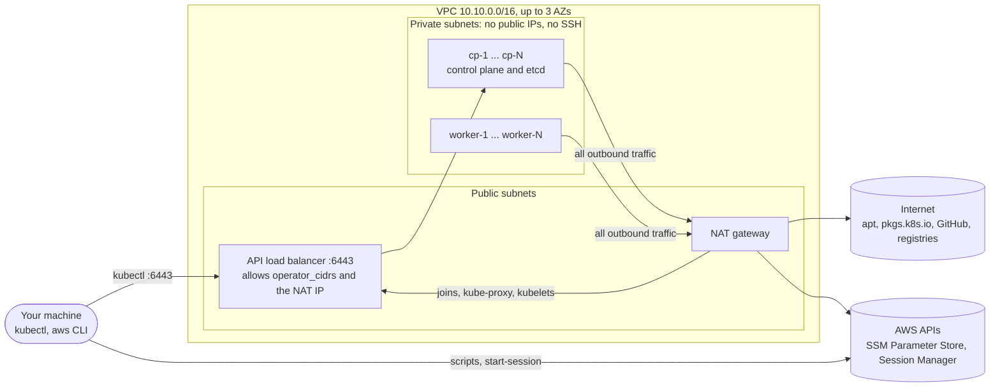
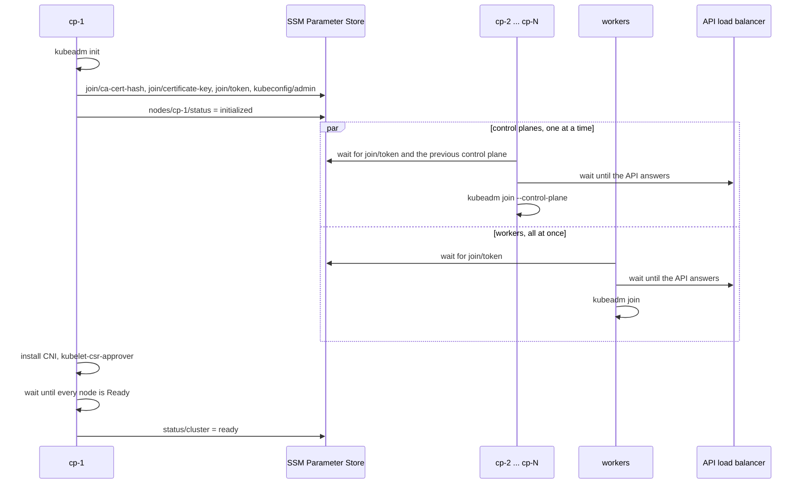

# Architecture

This page explains what Terraform builds, how traffic flows, and how the nodes turn
themselves into a cluster. Read it when you want to know why something works the way it does,
or before you change the code.

## What gets built

Every arrow starts at the side that opens the connection. Nothing on the internet can open a
connection to a node.

kubectl talks to an internet-facing Network Load Balancer (NLB) on port 6443. Its security
group only admits `operator_cidrs`.

The NLB is also kubeadm's `controlPlaneEndpoint`, so the nodes use it too. Its DNS name
resolves to public addresses even inside the VPC, so node traffic leaves through the NAT
gateway and comes back in. That's why the NLB security group also admits the NAT gateway's IP.
The target group has client IP preservation turned off. With it on, a control plane that the
NLB routes back to itself can't complete the connection.

The nodes install packages, download Calico or Cilium and pull images through the NAT gateway.
When that path breaks, bootstrap fails at the `packages` or `cni` step.

Session Manager needs no inbound port. The SSM Agent on each node opens an outbound connection
to AWS through the NAT gateway, your AWS CLI opens another from your machine, and AWS joins the
two. There are no VPC endpoints, so the NAT gateway carries this traffic as well.

## Code layout

| Path | What it holds |
|---|---|
| `main.tf`, `locals.tf` | The random cluster name, the node map (`cp-1`, `worker-1`, ...) and the two module calls |
| `modules/network` | The VPC, through `terraform-aws-modules/vpc`. It only uses AZs that offer your instance types, and it only hands out the private subnets once their NAT route exists |
| `modules/cluster/main.tf` | The EC2 instances and their cloud-init user data |
| `modules/cluster/iam.tf`, `security.tf`, `nlb.tf`, `ssm.tf` | Instance roles, security groups, the API load balancer, the SSM parameters |
| `modules/cluster/bootstrap` | Renders what each node boots with. It has no providers, so you can render it without AWS credentials |
| `modules/status` | Reads the status parameters for the `cluster_status` output and the `cluster_ready` check |
| `modules/cluster/bootstrap/files` | Shell scripts and systemd units, copied to the nodes as they are |
| `modules/cluster/bootstrap/templates` | kubeadm configs, `cluster.env` and add-on manifests, filled in by Terraform |

To follow a value from your settings to a node, take `calico_version`: `variables.tf`, then
`local.software` in `locals.tf`, then `var.software` in `modules/cluster` and in
`modules/cluster/bootstrap`, then `templates/cluster.env.tftpl`, which writes
`CALICO_VERSION=` to `/etc/kube-lab/cluster.env`. On the node, `lib.sh` sources that file and
`control-plane.sh` uses the variable.

## Why Terraform state holds no secrets

Terraform creates every SSM parameter with the placeholder value `pending`, using a
write-only argument (`value_wo`), which Terraform never stores or reads back. The nodes then
overwrite the parameters with the real join token, certificate key and admin kubeconfig.
Terraform has no Kubernetes or Helm provider: cp-1 installs the add-ons itself. So Terraform
never sees a cluster credential, and destroying the cluster still deletes every parameter.

The status parameters are different: they are plain `String` parameters, and Terraform reads
them (`modules/status`) to show progress. Their `allowed_pattern` makes SSM refuse anything
that isn't a status value, so a bug in a node script can't put a secret into one. Terraform
reads each status parameter by name, never the whole `/<cluster>/` path, which also holds the
secrets.

## Node permissions

Control planes and workers get separate IAM roles. Control planes can read and write every
parameter under `/<cluster>/`: they publish the join material, the admin kubeconfig and the
statuses. Workers can read only the join token and the CA certificate hash, never the admin
kubeconfig or the certificate key, and write any parameter under `/<cluster>/nodes/worker-*`.
All workers share one role, so a worker can overwrite another worker's status, and a node can
create extra parameters under the paths it may write, which `terraform destroy` doesn't
remove. No node waits on a worker's status, so a spoofed one only changes what you see.
Working out what else an attacker on a worker could do with that role is a good CKS exercise.

Both roles get Session Manager access through an inline policy instead of the managed
`AmazonSSMManagedInstanceCore` policy, because that one also allows `ssm:GetParameter` on every
parameter in the account. The inline policy has `ssm:UpdateInstanceInformation` and the four
`ssmmessages` channel actions, which is the
[minimal Session Manager policy](https://docs.aws.amazon.com/systems-manager/latest/userguide/getting-started-create-iam-instance-profile.html)
AWS documents. It has no `ec2messages` actions, so the agent can't receive Run Command
documents: Session Manager is the only way in, and every session shows up in the Session
Manager history.

Instances require IMDSv2 with a hop limit of 1, so pods on the pod network can't get
instance-role credentials. Pods with `hostNetwork: true` still can; the
[CKS lab](labs/cks.md#keep-pods-away-from-instance-credentials) shows how to deal with that.

## AWS permissions

The simplest setup is an admin role in a sandbox account. If you use a narrower role, it needs
these permissions.

To run `terraform apply` and `terraform destroy`, the role must be able to:

| Service | What Terraform does |
|---|---|
| EC2 and VPC | Create, tag and delete the VPC, subnets, route tables, internet gateway, NAT gateway, Elastic IP, security groups and rules, and instances, and tag their root volumes. Read with `ec2:Describe*`, which covers `DescribeAvailabilityZones`, `DescribeInstanceTypeOfferings` and `DescribeInstanceTypes` |
| Elastic Load Balancing | Create, tag and delete a Network Load Balancer, a target group and a listener, and register targets |
| IAM | Create and delete roles, inline role policies and instance profiles named after the cluster, and `iam:PassRole` for those roles |
| SSM Parameter Store | Create, tag and delete parameters under `/<cluster>/`, and read the public Ubuntu AMI ID under `/aws/service/canonical/` |
| STS | `sts:GetCallerIdentity` |

For the helper scripts and node shells:

| Action | Used by |
|---|---|
| `ssm:GetParameter` | `get-kubeconfig.sh`, `wait-for-cluster.sh` |
| `ssm:GetParametersByPath` | `wait-for-cluster.sh` (node statuses) |
| `ssm:GetParameterHistory` | `wait-for-cluster.sh --history` |
| `ssm:StartSession`, `ssm:TerminateSession`, `ssm:ResumeSession` | `aws ssm start-session` |

The parameters are encrypted with the AWS managed key `aws/ssm`. Its key policy lets every
principal in your account decrypt through SSM, so you don't need a separate KMS permission.

## Bootstrap contract

This section is the reference for how the nodes build the cluster. The code that implements it
is spread across `modules/cluster/bootstrap`, `modules/cluster/ssm.tf`, `modules/cluster/iam.tf`
and the two helper scripts.

### Boot sequence

Each node boots with two cloud-init parts: a cloud-config that writes its files (see
[File map](#file-map)) and one role script, `control-plane.sh` or `worker.sh`. Every node starts
the same way: install the AWS CLI, prepare the host (swap off, kernel modules, sysctls), then
install containerd, kubeadm, kubelet and kubectl. After that the roles split.

cp-1 installs two add-ons and nothing else. The network plugin gives pods their addresses.
kubelet-csr-approver approves the certificate each kubelet requests for its own HTTPS port.
The kubeadm config sets `serverTLSBootstrap: true`, so kubelets ask the cluster's certificate authority
for that certificate instead of signing their own. Until it is approved, commands that go
through the kubelet, such as `kubectl logs` and `kubectl exec`, fail, and so would
metrics-server if you install it. Everything else is up to you: [Add-ons](addons.md) shows how.

cp-1 publishes the join material as soon as `kubeadm init` finishes, so the other nodes join
while it installs the add-ons. Control planes join one at a time because kubeadm adds each new
etcd member as a learner, and etcd allows one learner at a time. cp-2 waits for cp-1 to reach
`initialized`, cp-3 waits for cp-2 to reach `joined`, and so on.

cp-1 also enables `kube-lab-refresh-join.timer`, which publishes a fresh 24-hour join token
every 12 hours and five minutes after every boot. Nodes you add days later, or after you
restart a stopped cluster, still find a valid token.

### Status values

Each node writes its progress to `/<cluster>/nodes/<node>/status`. cp-1 also writes the
cluster's progress to `/<cluster>/status/cluster`.

| Node status | Meaning |
|---|---|
| `pending` | Terraform's placeholder. The node hasn't installed the AWS CLI yet, which usually takes under a minute. |
| `bootstrapping` | The AWS CLI works. The node is preparing the host and installing packages. |
| `initializing` | cp-1 only: `kubeadm init` is running. |
| `initialized` | cp-1 only: the control plane is up and the join material is published. cp-1 now installs the add-ons and waits for every node, which can take up to 30 minutes. |
| `waiting` | Joining nodes: waiting for the join token, for the previous control plane, and for the API through the load balancer. |
| `joining` | Joining nodes: `kubeadm join` is running. |
| `joined` | Done. |
| `failed:<step>` | The named step failed. [Troubleshooting](troubleshooting.md) lists every step. |

| Cluster status | Meaning |
|---|---|
| `pending` | cp-1 hasn't finished `kubeadm init` yet. |
| `installing` | The admin kubeconfig is published and kubectl works. cp-1 is installing the add-ons and waiting for every node. |
| `ready` | Every node is `Ready` and cp-1 has finished. |
| `failed:<step>` | cp-1 failed at the named step. |

The steps, in order, are `awscli`, `host`, `packages`, `containerd` and `shell` on every node.
cp-1 then runs `init`, `publish`, `local-kubeconfig`, `cni`, `csr-approver`,
`refresh-timer` and `wait-nodes`; the other nodes run `join`. Control planes finish with
`root-kubeconfig`, then `helm` when `helm_enabled` is set, before they report `joined`. Every
failure reports the step that was running. The one exception is a node that can't install the
AWS CLI: it can't report anything and stays at `pending`.

### SSM parameters

All parameters live under `/<cluster>/`. The join material and the admin kubeconfig are
SecureStrings; the status parameters are plain Strings. `terraform output ssm_parameter_prefix`
prints the prefix.

| Parameter | Written by | Read by |
|---|---|---|
| `join/token` | cp-1, at init and every 12 hours | every joining node |
| `join/ca-cert-hash` | cp-1 | every joining node |
| `join/certificate-key` | cp-1, at init and by `kube-lab-refresh-join --upload-certs` | joining control planes (workers can't read it) |
| `kubeconfig/admin` | cp-1 | you, through `get-kubeconfig.sh` (workers can't read it). An Advanced parameter, because the kubeconfig is larger than 4 KB |
| `status/cluster` | cp-1 | you, through `wait-for-cluster.sh`, and Terraform (`cluster_status`) |
| `nodes/<node>/status` | that node (any worker can write a worker's) | you, Terraform, and the next control plane in line |

### Two templating passes

The files in `modules/cluster/bootstrap/templates` are filled in twice:

- `${x}` is filled in by Terraform's `templatefile` when you plan. These are names, versions
  and CIDRs.
- `$${X}` reaches the node as `${X}`, and `envsubst` fills it in at boot. Only the kubeadm
  configs use this, for `PRIVATE_IP`, `JOIN_TOKEN`, `CA_CERT_HASH` and `CERT_KEY`. The node
  writes the result to `/run/kube-lab`, a tmpfs, and deletes it when the script exits. That is
  how join secrets stay out of Terraform and off the disk. Each kubeadm template starts with a
  comment that repeats this.

### File map

| Path on the node | Source in `modules/cluster/bootstrap` | Nodes | Mode |
|---|---|---|---|
| `/etc/kube-lab/cluster.env` | `templates/cluster.env.tftpl` | all | 0600 |
| `/etc/kube-lab/lib.sh` | `files/lib.sh` | all | 0600 |
| `/etc/kube-lab/kubeadm-init.yaml.tmpl` | `templates/kubeadm-init.yaml.tftpl` | cp-1 | 0600 |
| `/etc/kube-lab/kubeadm-join.yaml.tmpl` | `templates/kubeadm-join.yaml.tftpl` | all except cp-1 | 0600 |
| `/etc/kube-lab/kubelet-csr-approver.yaml` | `templates/kubelet-csr-approver.yaml.tftpl` | cp-1 | 0600 |
| `/etc/kube-lab/calico-installation.yaml` | `templates/calico-installation.yaml.tftpl` | cp-1, with Calico | 0600 |
| `/usr/local/sbin/kube-lab-refresh-join` | `files/kube-lab-refresh-join.sh` | cp-1 | 0700 |
| `/etc/systemd/system/kube-lab-refresh-join.service` and `.timer` | `files/` | cp-1 | 0644 |
| `/var/lib/cloud/instance/scripts/<role>.sh` | `files/control-plane.sh` or `files/worker.sh` | all | set by cloud-init |

At runtime the scripts also use:

| Path | Purpose |
|---|---|
| `/var/log/kube-lab-bootstrap.log` | The bootstrap log. It never holds the join token or the kubeconfig |
| `/var/lib/kube-lab/<step>.done` | One marker per finished step, so a re-run skips it |
| `/run/kube-lab/` | On tmpfs: filled-in kubeadm configs and cp-1's local admin kubeconfig, deleted when the script exits |
| `/usr/local/aws-cli/`, `/usr/local/bin/aws` | The AWS CLI v2, from AWS's zip installer (`aws_cli_version`) |
| `/etc/kube-lab/calico/` | Calico manifests cp-1 downloads and checks against their sha256 |
| `/usr/local/bin/helm` | The Helm CLI, on control planes with `helm_enabled` |

### Reading order

To follow the code from user data to kubeadm, read these in order:

1. `locals.tf` and `main.tf` in the root: the node map and the two modules.
2. `modules/cluster/main.tf`: the instances and their two cloud-init parts.
3. `modules/cluster/bootstrap/main.tf`: which files each node gets.
4. `modules/cluster/bootstrap/templates/cluster.env.tftpl`: every value the scripts read.
5. `modules/cluster/bootstrap/files/worker.sh`, then `lib.sh`: the path every joining node takes.
6. `modules/cluster/bootstrap/files/control-plane.sh`: cp-1's init and add-ons.
7. The two kubeadm templates.
8. `modules/cluster/ssm.tf` and `iam.tf`: where join material lives and who can read it.
