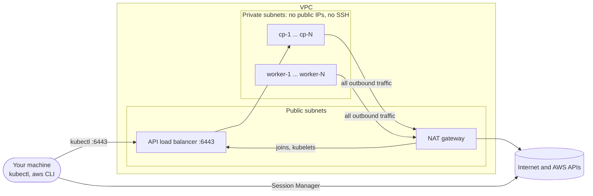
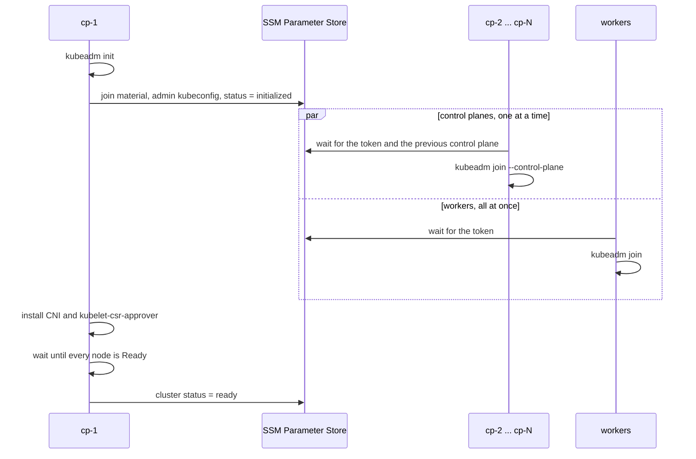

# Architecture

This page explains how traffic flows, how the nodes turn themselves into a cluster, and why
some things work the way they do. Read it before you change the code.

## Network



Arrows start at the side that opens the connection. Nothing on the internet can open a
connection to a node.

The Network Load Balancer (NLB) is also kubeadm's `controlPlaneEndpoint`, the API address every
node uses. Its DNS name resolves to public addresses even inside the VPC, so node traffic leaves
through the NAT gateway and comes back in. That's why the NLB security group admits the NAT
gateway's IP as well as `operator_cidrs`. Client IP preservation is off, because with it on, a
control plane that the NLB routes back to itself can't complete the connection.

Everything else the nodes need also goes through the NAT gateway: packages, images, the network
plugin, SSM Parameter Store and Session Manager. There are no VPC endpoints. When that path
breaks, a node stays `pending` or fails at `packages` or `cni`.

## Security trade-offs

kube-lab keeps the cluster's secrets out of Terraform state. Beyond that, it favors a setup you
can read in one sitting over a hardened one.

- Terraform creates every SSM parameter with the placeholder `pending` through a write-only
  argument, which it never stores. The nodes write the real join token, certificate key and
  admin kubeconfig. Terraform has no Kubernetes or Helm provider.
- The status parameters are plain Strings, so Terraform can read them to show progress. An
  `allowed_pattern` makes SSM refuse anything that isn't a status value.
- Workers can read only the join token and the CA hash, never the admin kubeconfig or the
  certificate key. But all workers share one IAM role, so a worker can overwrite another
  worker's status.
- On cp-1, the join token and certificate key appear on the AWS CLI's command line while it
  publishes them, so `ps` can show them.
- The nodes use a minimal Session Manager policy instead of `AmazonSSMManagedInstanceCore`,
  which would let any node read every parameter in your account. It leaves out Run Command.
- IMDSv2 with a hop limit of 1 keeps the node's IAM credentials from pods on the pod network,
  but not from `hostNetwork` pods.
- The nodes may reach each other and the internet on every port.

The [CKS lab](labs/cks.md#review-the-labs-own-shortcuts) turns these into exercises.

## AWS permissions

An admin role in a sandbox account is the easy path. A narrower role needs to create, tag, read
and delete these, all named after the cluster: the VPC and its networking (subnets, route tables,
gateways, an Elastic IP, security groups), EC2 instances, a Network Load Balancer with its
target group and listener, IAM roles, policies and instance profiles (plus `iam:PassRole`), and
SSM parameters under `/<cluster>/`. It also needs `ec2:Describe*`, `sts:GetCallerIdentity` and
read access to the public Ubuntu AMI parameter under `/aws/service/canonical/`.

The helper scripts need `ssm:GetParameter` and `ssm:GetParametersByPath`, plus
`ssm:GetParameterHistory` for `wait-for-cluster.sh --history`. Node shells need
`ssm:StartSession`, `ssm:TerminateSession` and `ssm:ResumeSession`. The secrets use the AWS
managed key `aws/ssm`, so you need no extra KMS permission.

## Bootstrap contract

Each node boots with a cloud-config that writes its files and one role script,
`control-plane.sh` or `worker.sh`. `modules/cluster/bootstrap/main.tf` shows which files reach
which node. Every node first installs the AWS CLI, prepares the host and installs containerd,
kubeadm, kubelet and kubectl. Then the roles split.



cp-1 publishes the join material right after `kubeadm init`, so the other nodes join while it
installs the add-ons. Control planes join one at a time because etcd allows one learner member
at a time.

cp-1 installs only two add-ons. The network plugin gives pods their addresses.
kubelet-csr-approver approves the certificate each kubelet requests for its HTTPS port, because
the kubelets use `serverTLSBootstrap: true` instead of signing their own. Until a kubelet's
certificate is approved, `kubectl logs` and `kubectl exec` on that node fail.

cp-1 also enables `kube-lab-refresh-join.timer`. It publishes a fresh 24-hour join token every
12 hours and five minutes after every boot, so nodes you add later still find a valid token.

### Status values

Each node writes its progress to `/<cluster>/nodes/<node>/status`, and cp-1 writes the
cluster's progress to `/<cluster>/status/cluster`:

```text
cp-1            pending -> bootstrapping -> initializing -> initialized -> joined
other nodes     pending -> bootstrapping -> waiting -> joining -> joined
cluster         pending -> installing -> ready
```

Any of them can end in `failed:<step>`. A node can't report until it has installed the AWS
CLI, so `pending` is Terraform's placeholder. The cluster turns `installing` once the admin
kubeconfig is published, and `ready` once every node is `Ready`.
[Troubleshooting](troubleshooting.md#status-values) explains each value and each step.

### SSM parameters

Everything lives under `/<cluster>/` (`terraform output ssm_parameter_prefix`).

| Parameter | Written by | Read by |
|---|---|---|
| `join/token`, `join/ca-cert-hash` | cp-1, the token again every 12 hours | every joining node |
| `join/certificate-key` | cp-1, and `kube-lab-refresh-join --upload-certs` | joining control planes |
| `kubeconfig/admin` | cp-1 | you, through `get-kubeconfig.sh` |
| `status/cluster` | cp-1 | you, and Terraform |
| `nodes/<node>/status` | that node | you, Terraform, and the next control plane in line |

The first four are SecureStrings. `kubeconfig/admin` is an Advanced parameter, because the
kubeconfig is larger than 4 KB.

### Two templating passes

The files in `modules/cluster/bootstrap/templates` are filled in twice. Terraform fills in
`${x}` at plan time: names, versions and CIDRs. `$${X}` reaches the node as `${X}`, and
`envsubst` fills it in at boot with the private IP and the join secrets. The node writes the
result to `/run/kube-lab`, a tmpfs, and deletes it when the script exits. That keeps join
secrets out of Terraform and off the disk.

## Reading the code

To follow the code from user data to kubeadm, start at `locals.tf` and `main.tf`, then
`modules/cluster/main.tf`, `modules/cluster/bootstrap/main.tf` and
`templates/cluster.env.tftpl`. On the node side, read `worker.sh`, `lib.sh`, then
`control-plane.sh`. `ssm.tf` and `iam.tf` in `modules/cluster` show who can read what.
